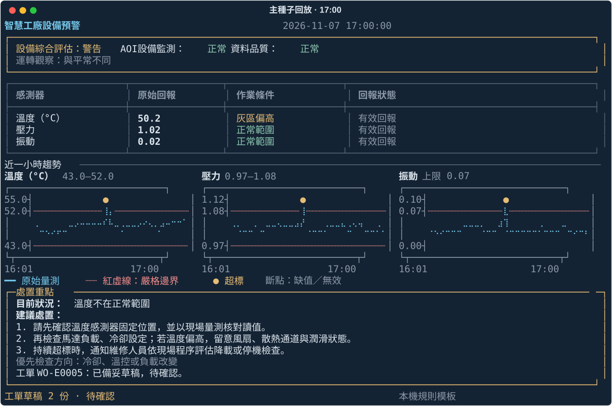
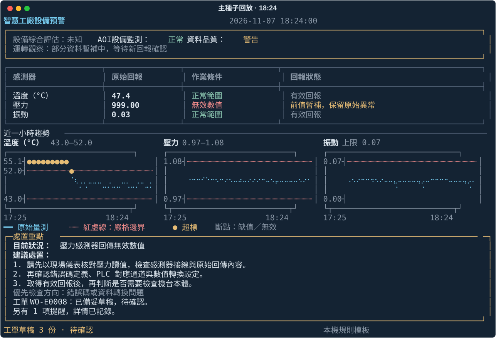
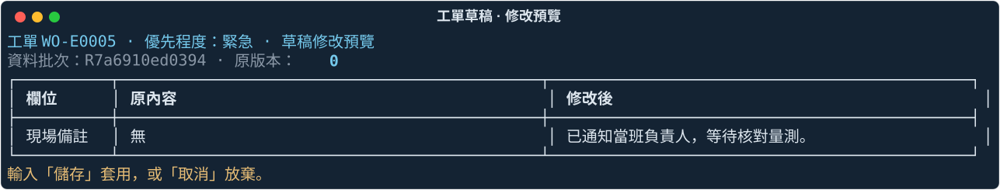
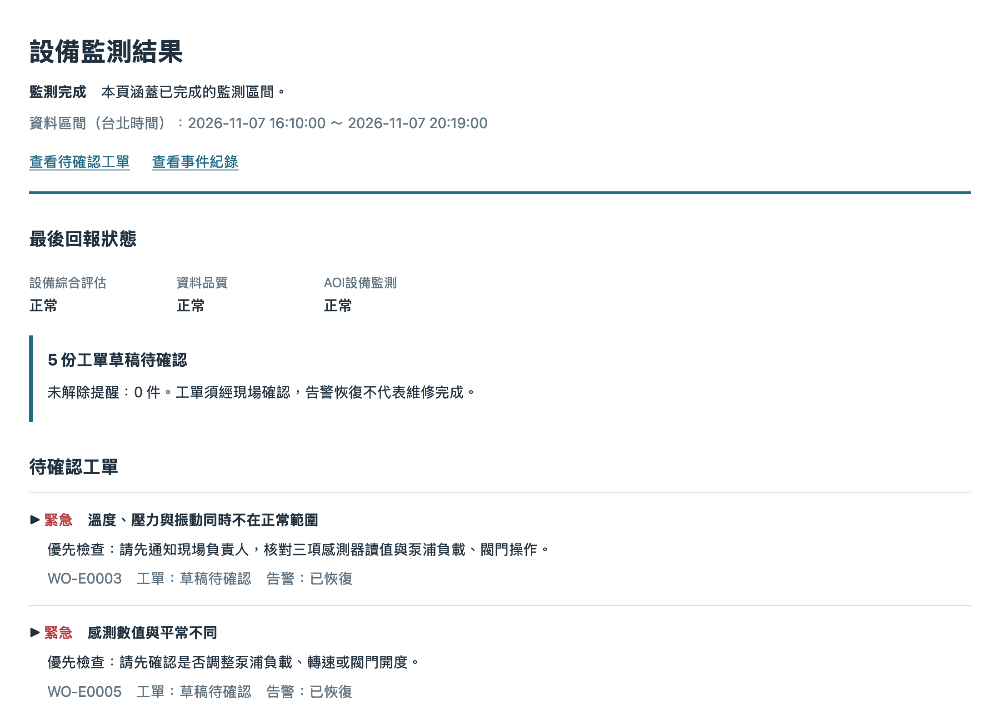
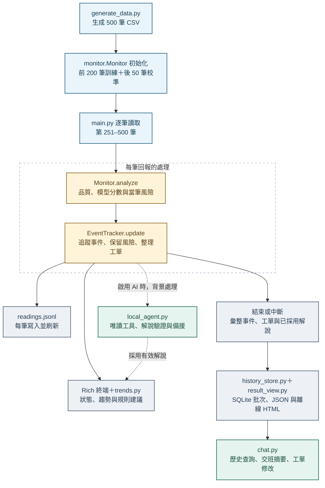
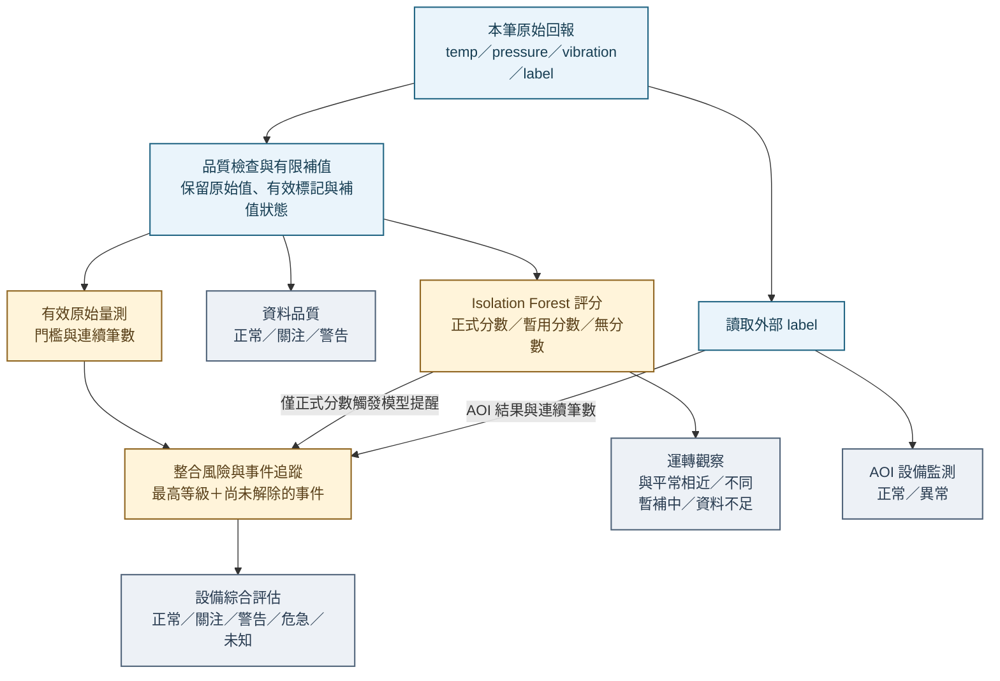
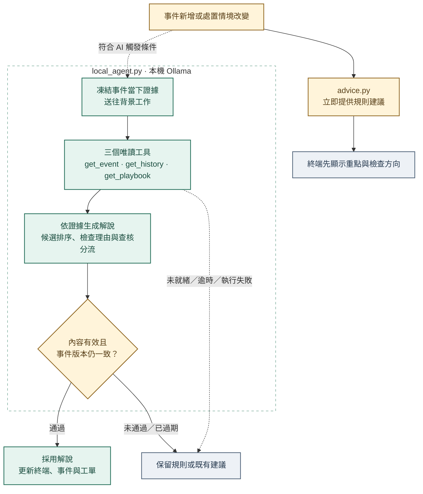
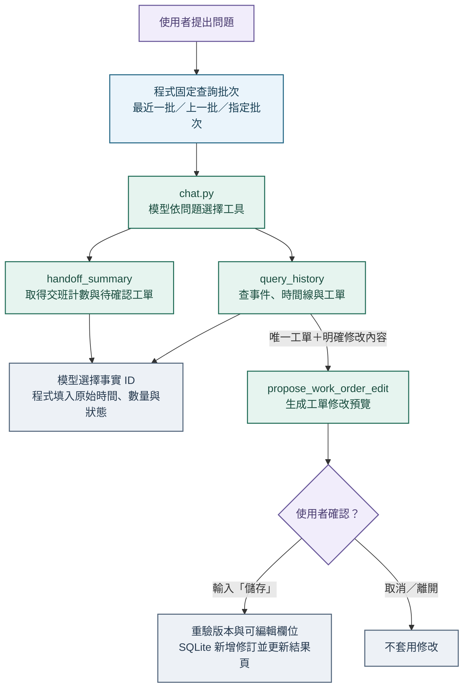

# 智慧工廠設備異常預警 AI Agent

以馬達驅動泵浦為情境，將模擬感測資料轉成異常提醒、檢查建議與工單草稿。系統先完成規則與機器學習判定，再由本機 Ollama 說明處置方向；監測結束後可查歷史、整理交班摘要及修改工單草稿。

> [!NOTE]
> **主種子提前預警**：溫度漂移在 17:00 出現模型警告，比 17:09 首次嚴格超標**提前 9 分鐘**。這是模擬資料時間的提前量，評估範圍與限制見第三部分。

| [系統提供的功能](#features) | [如何使用系統](#usage) | [架構與實作細節](#architecture) |
| :--- | :--- | :--- |
| 查看畫面、提醒與處置協助 | 安裝、啟動、問答與結果閱讀 | 資料、模型、Agent 與驗證 |

面試文件：[作業說明](docs/assignment%20explanation.md) ／ [背景調查](docs/background%20research.md) ／ [協作計畫與實作清單](docs/project%20plan.md) ／ [AI 工具使用說明](docs/ai-tool-usage.md)

定稿成果：[15 頁 PDF 簡報](output/pdf/pegatron-presentation.pdf) ／ [3 頁技術報告](output/pdf/pegatron-technical-report.pdf) ／ [可編輯 PPTX](output/pptx/pegatron-presentation.pptx)

<a id="features"></a>

## 一、系統提供的功能

機台負責人可以從同一個終端查看設備回報、判斷處理優先順序，並留下可供檢查與交班的紀錄。



<sub>主種子第 301 筆，純終端模式：溫度 50.2°C，尚未嚴格超標，模型已觸發警告。圖表中的較早尖峰為先前的突發事件。</sub>

| 功能 | 使用者可以得到什麼 |
| --- | --- |
| **查看量測與趨勢** | 同時查看溫度、壓力、振動，以及最近一小時的變化與嚴格邊界 |
| **接收分級提醒** | 區分正常、關注、警告與危急，知道目前是否需要優先處理 |
| **掌握回報品質** | 看出哪個感測器未回報、數值無效或正在暫補，避免把資料問題當成設備故障 |
| **取得檢查建議** | 知道先核對哪個感測器，再檢查對應的管路、冷卻或傳動部件 |
| **自動整理工單草稿** | 警告以上事件建立草稿，包含異常依據、候選原因與建議步驟，供負責人確認 |
| **離線閱讀結果** | 監測結束或中斷後，用瀏覽器查看中文摘要、事件與工單，不必閱讀 JSON |
| **查詢歷史** | 查找已保存批次中的事件、工單與發生時間，確認預警和超標的先後 |
| **整理交班摘要** | 取得事件、告警恢復及待確認工單的重點，保留後續需要追蹤的事項 |
| **修改工單草稿** | 用文字要求調整摘要、說明或現場備註，完整預覽後再決定是否儲存 |

純終端模式即可使用監測、趨勢、分級提醒、固定檢查建議、草稿與離線結果。啟用地端 AI 後，增加依當時狀況生成的檢查理由、現場查核後的下一步，以及歷史查詢、交班摘要、工單修改三項問答。

典型操作流程：**啟動監測 → 查看提醒與檢查建議 → 閱讀結果及草稿 → 查歷史或整理交班 → 預覽並確認工單修改**。工單維持待確認草稿，告警恢復不代表維修完成。

<a id="usage"></a>

## 二、如何使用系統

### 1. 取得專案並安裝

驗收環境為 **macOS、Python 3.9.6**。以下使用 macOS／Linux shell；其他作業系統與 Python 版本尚未完成驗收。

```bash
git clone https://github.com/alanhsu0531/-Pegatron-Smart-Factory-Alert-Agent.git smart-factory-alert-agent
cd smart-factory-alert-agent
python3 -m venv .venv
source .venv/bin/activate
python -m pip install -r requirements.txt
```

CSV 已包含於儲存庫，首次使用不必重新生成。以下指令均在專案根目錄、已啟用 `.venv` 的終端執行；後續重新開啟終端時，先執行 `source .venv/bin/activate`。

### 2. 先跑完整純終端流程

```bash
python main.py --no-ollama
```

預設每 0.5 秒讀下一筆，250 筆監測約需 125 秒，另加計算與畫面更新時間。無需安裝 Ollama，即可看到感測器、風險、三張趨勢、檢查建議及工單草稿；結束後產生 `outputs/results.html`，直接用瀏覽器開啟。

```bash
python main.py --no-ollama --interval 0
```

這條指令快速重播，適合檢查完整輸出；若要觀察畫面變化，使用預設間隔或較大的值。

### 3. 啟用地端 AI 與監測後問答

依 [Ollama 官方安裝說明](https://docs.ollama.com/quickstart)安裝並啟動服務，再下載本專案指定的[模型](https://ollama.com/library/qwen3%3A4b-instruct)：

```bash
ollama pull qwen3:4b-instruct
ollama list
python main.py
```

macOS 可直接開啟 Ollama App；若採 CLI 啟動且服務尚未執行，在另一個終端執行 `ollama serve` 並保持開啟。專案固定連線本機 11434 埠，不需 API 金鑰，也不要求關閉 Ollama 的全域雲端功能。

初始化完成後照常播放資料。畫面中的「規則建議 · AI 整理中」代表先用規則處置，待模型完成後更新。完整播放結束且輸入、輸出均為互動終端時，會自動進入問答；可輸入「離開」結束。模型未就緒或逾時時，監測仍保留規則建議；問答則提示錯誤並保留紀錄。

模型速度依硬體與執行狀況而異，快速播放不保證每項解說在事件結束前完成。結果頁與工單會保留已通過驗證的解說及依據時間。

### 4. 怎麼讀終端畫面

| 區域 | 意義 |
| --- | --- |
| 設備綜合評估 | 目前的整體提醒等級，包含尚未解除的設備事件 |
| AOI 設備監測 | 本筆外部檢測結果，與設備整體評估分開顯示 |
| 資料品質 | 感測器是否漏報、回傳無效值或正在暫補 |
| 運轉觀察 | 感測數值組合與平常相近或不同；暫補中或資料不足時另行提示 |
| 感測器表格 | 原始回報、作業條件及回報是否有效／暫補 |
| 近一小時趨勢 | 最近 60 筆原始量測；紅虛線為嚴格邊界，超標另標記；缺值與無效值留斷點 |
| 處置重點 | 優先事件的檢查步驟，或 AI 情境、理由與查核分流 |

例如 AOI 可顯示正常，但設備仍因溫度超標而警告；事件進入恢復觀察時，當筆量測已正常，設備等級仍會暫時保留。畫面採固定欄寬，較矮視窗會縮短處置顯示；完整內容保留於 HTML。請在一般互動終端觀看，重新導向到檔案時不繪製即時儀表板。



<sub>主種子第 385 筆，純終端模式：999 保留於原始回報，列為資料品質問題；圖表不繪製這個無效值。</sub>

### 5. 直接查歷史、交班與修改草稿

至少完成一次監測後，隨時執行：

```bash
python main.py --chat
```

| 目的 | 可輸入的問題 |
| --- | --- |
| 查事件 | `查詢溫度事件` |
| 查提前量 | `查詢 E0005 的模型警告、首次嚴格超標時間與提前分鐘` |
| 交班 | `整理本次交班摘要` |
| 前一批 | `整理上一批交班摘要` |
| 修改草稿 | `修改 WO-E0005，將工單說明改成適合交班閱讀的三個重點` |
| 加現場備註 | `修改 WO-E0005，現場備註加入：已通知當班負責人，等待核對量測` |

`E0005`／`WO-E0005` 是標準主種子流程的範例；請以實際結果中的編號為準。只輸入 `修改 WO-E0005` 時，系統會先詢問修改內容。預覽出現後，輸入 `儲存` 或 `取消`；儲存新增一版草稿，不代表派工。



<sub>使用既有預覽介面呈現示範備註，尚未儲存，也沒有寫入人工修訂。</sub>

> [!IMPORTANT]
> 工單修改需由使用者確認「儲存」才生效。所有工單仍為草稿，告警恢復不代表維修完成。

若監測使用自訂輸出目錄，問答也要指定相同目錄，例如 `python main.py --chat --output-dir outputs/demo`。所有問題只操作指定批次的既有紀錄，不提供一般知識庫或任意工具問答。

### 6. 指令參數與中斷

<details>
<summary><strong>查看所有命令列參數</strong></summary>

| 參數 | 預設 | 用途 |
| --- | --- | --- |
| `--csv` | 專案內 `data/sensor_data.csv` | 改用相同五欄、500 筆、每分鐘一筆的 CSV |
| `--output-dir` | 專案內 `outputs/` | 指定結果與歷史庫目錄 |
| `--interval` | `0.5` | 每筆暫停秒數，0 為快速重播，須為有限非負數 |
| `--no-ollama` | 未啟用此旗標 | 使用規則建議、不連線模型、不自動進入問答 |
| `--chat` | 未啟用此旗標 | 只開啟已保存紀錄的問答，不重播 CSV |

</details>

例如以一秒間隔另存一批純終端結果：

```bash
python main.py --no-ollama --interval 1 --output-dir outputs/demo
```

播放中按 `Ctrl+C` 會停止、保存已處理的部分結果，且不自動進入問答。不要同時將多個監測程序寫入同一個輸出目錄。

<a id="results"></a>

### 7. 結果存在哪裡，會不會覆蓋

機台負責人的主要入口為 `outputs/results.html`，監測結束或中斷後可直接用瀏覽器離線開啟。



<sub>主種子完整回放的結果頁上半部，採純終端建議；下方另有完整工單與事件紀錄。</sub>

<details>
<summary><strong>查看輸出檔案與寫入時機</strong></summary>

| 檔案 | 內容與寫入時機 |
| --- | --- |
| `outputs/results.html` | 中文摘要、事件與維修工單；結束或中斷時產生，可離線開啟 |
| `outputs/readings.jsonl` | 每筆風險、分數、原始值與品質狀態；執行中逐筆寫入 |
| `outputs/events.json` | 事件、當前與歷史風險證據、解說；結束或中斷時保存 |
| `outputs/work_orders.json` | 工單草稿；結束保存，確認最新批次的人工修訂時更新 |
| `outputs/summary.json` | 本次批次 ID、筆數與執行摘要；結束或中斷時保存 |
| `outputs/history.sqlite3` | 每次執行的快照、逐筆紀錄與人工修訂版本 |
| `outputs/agent_trace.jsonl` | 本次監測的模型請求、工具與採用／備援紀錄 |
| `outputs/chat_trace.jsonl` | 問答與工具紀錄；問答期間追加 |
| `outputs/history/<批次 ID>/results.html` | 人工確認修訂後產生的該批結果頁 |
| `outputs/model_evaluation.json` | 另行執行模型評估後產生的技術結果 |

</details>

**同一輸出目錄的最新 JSON／HTML 會在下一次監測更新**；逐筆與監測 Agent 紀錄從開始時重建，事件與摘要等在結束時更新，執行途中它們可能仍屬上一批。SQLite 會新增批次並保留原始快照及修訂，問答紀錄持續追加。需要每次獨立檔案時使用不同 `--output-dir`。

要保留跨批次紀錄及人工備註，請備份 `history.sqlite3`；若要連同原始模型回覆與結果頁一起保留，備份整個輸出目錄。生成器可重現固定資料；重新推論不能保證逐字重現舊模型文字。`outputs/` 已由 Git 忽略，不上傳個人備註與執行紀錄。

### 8. 常見狀況

| 狀況 | 處理方式 |
| --- | --- |
| 找不到 Python 套件 | 啟用 `.venv`，使用同一個 Python 執行 `python -m pip install -r requirements.txt` |
| 指定本機模型尚未就緒 | 開啟 Ollama，執行 `ollama pull qwen3:4b-instruct`，並用 `ollama list` 確認模型名稱 |
| 模型不支援工具或無法連線 | 核對指定模型及本機 11434 服務；監測可先加 `--no-ollama` 執行 |
| 問答提示沒有監測紀錄 | 先完成一次監測；核對 `--chat` 的 `--output-dir` 與先前相同 |
| 模型逾時或回覆未採用 | 保留規則建議與既有紀錄；問答可縮短問題後再試 |
| 工單已有新版本 | 重新查詢並建立預覽，再確認儲存 |

實作與逐階段驗收過程見[專案計畫](docs/project%20plan.md)。簡報、技術報告及其中的展示截圖均已定稿，檔案見頁首「定稿成果」。

<a id="architecture"></a>

## 三、專案架構與實作細節

| 流程圖 | 閱讀重點 |
| --- | --- |
| [整體資料流](#system-flow) | 從 CSV 初始化、逐筆監測到結束保存，各模組如何接續 |
| [四項狀態判定](#status-flow) | 同一筆回報如何形成設備、品質、運轉觀察與 AOI 狀態 |
| [監測中 AI 解說](#live-agent-flow) | 規則先回覆，模型在背景查工具並補充建議 |
| [問答與工單確認](#chat-flow) | 三項工具如何查紀錄，以及人工確認後才儲存修改 |

圖中以**藍色表示資料與處理、琥珀色表示判定、青綠色表示 AI、紫色表示人工確認、灰色表示紀錄與輸出**；節點文字與箭頭也保留各自的意義。

<a id="system-flow"></a>

### 1. 整體流程

`main.py` 串接監測流程；數值判定集中在 `monitor.py`，AI 解說與保存各自負責一段工作。



實線是主要資料流，虛線是背景 AI 解說。`readings.jsonl` 執行中逐筆寫入；SQLite 批次與結果頁在結束或中斷時保存。完整播放且處於互動終端時，自動接續問答；也能用 `--chat` 另開已保存紀錄。

監測器與 Agent 不讀取生成註記，也不取得尚未播放的資料。`evaluate_model.py` 另以 CSV 與獨立生成註記進行離線評估，不介入即時判定。

<details>
<summary><strong>原始碼導讀：各模組的責任</strong></summary>

| 檔案／模組 | 責任 |
| --- | --- |
| [generate_data.py](generate_data.py) | 生成、檢查與輸出 CSV 及獨立事件註記 |
| [main.py](main.py) | 命令列入口、監測流程、終端畫面與結束保存 |
| [monitor.py](factory_agent/monitor.py) | CSV 驗證、品質檢查、模型分數、風險及事件生命週期 |
| [advice.py](factory_agent/advice.py) | 依感測器組合提供根因候選與固定檢查步驟 |
| [local_agent.py](factory_agent/local_agent.py) | 本機模型檢查、監測中工具呼叫、解說驗證與備援 |
| [history_store.py](factory_agent/history_store.py) | SQLite 批次、查詢、交班計數及工單修訂 |
| [chat.py](factory_agent/chat.py) | 監測後問答、事實選擇、工單修改預覽與確認 |
| [result_view.py](factory_agent/result_view.py) | 產生機台負責人可離線閱讀的中文 HTML |
| [trends.py](factory_agent/trends.py)、[theme.py](factory_agent/theme.py) | 近期時間序列圖與共用配色 |
| [evaluate_model.py](evaluate_model.py) | 逐筆模型指標、正常情境提醒及漂移提前量 |
| [tests/](tests/) | 資料、監測、Agent、問答、趨勢與結果頁的回歸驗證 |

數值處理由 NumPy、pandas、SciPy 與 scikit-learn 負責；終端採 Rich、plotext；問答以 OpenCC 統一繁體中文。HTTP 與資料庫使用 Python 標準函式庫，無額外 Agent 框架或外部資料庫服務。

</details>

### 2. 模擬資料生成

交付檔案為 [sensor_data.csv](data/sensor_data.csv)，固定 seed 42，共 **500 筆、每分鐘一筆**。時間為 **2026-11-07 12:00:00–20:19:00**，依台北時間解讀；CSV 本身不含時區欄位。

| 欄位 | 意義 | 正常範圍 | 嚴格異常 | 回報精度 |
| --- | --- | --- | --- | --- |
| `timestamp` | 資料時間 | 每分鐘遞增 | — | 秒 |
| `temp` | 溫度 | 45–50°C | <43 或 >52 | 1 位小數 |
| `pressure` | 壓力 | 1.00–1.05 | <0.97 或 >1.08 | 2 位小數 |
| `vibration` | 振動 | 0.02–0.04 | >0.07 | 2 位小數 |
| `label` | 模擬外部設備狀態 | `normal` | `abnormal` | — |

正常區間外、尚未嚴格超標的值稱為灰區；等於嚴格邊界也不算超標。作業未指定壓力與振動單位，因此不另加單位。

**基線與欄位關係。** 事件注入及量化前，溫度採常態分布 `N(47.5, 0.7²)`，壓力採 `N(1.025, 0.007²)`；振動採 Gamma，`shape=36`、`scale=0.03/36`，平均 0.03、標準差 0.005，保持正值。

三欄由相關常態潛在序列生成：`z_t = 0.8 z_(t-1) + 0.6 ε_t`，擾動相關矩陣為 `[[1,.55,.75],[.55,1,.65],[.75,.65,1]]`。壓力與振動取當分鐘狀態，溫度取兩分鐘前狀態；振動再經常態累積分布與 Gamma 反函數轉換。這用來近似共同負載與熱反應延遲，完整公式見[計畫書第 3 節](docs/project%20plan.md#3-資料生成)。

**標籤與回傳問題。** 先將設備量測量化，再產生 label，最後注入通訊問題與缺值。任一欄嚴格超標必為 abnormal；否則灰區欄數 0／1／2／3 對應 abnormal 機率 1%／10%／40%／80%。因此 label 與量測有條件關聯，並非獨立真實故障答案。

| 資料列，不含標頭 | 注入情境 | 監測上的用途 |
| --- | --- | --- |
| 270 | 三欄同時突發超標 | 即時危急提醒 |
| 295–349 | 溫度漸升、維持超標及恢復 | 模型提前提醒與風險升級 |
| 365–372 | 振動連續同值 | 驗證穩態與卡值無法僅靠現有欄位區分 |
| 385 | 壓力回傳 999 | 資料品質警告 |
| 400–419 | 三欄同時偏高但未嚴格超標 | 灰區聯合異常 |
| 450–453 | 溫度連續缺值 | 有限補值、資料不足與恢復觀察 |
| 其他監測列 | 隨機挖空 8 格 | 零星未回報 |

最終資料有 **62 筆 abnormal（12.4%）、12 格缺值與一筆 999**。連續同值只留下背景計數，不觸發卡值告警。生成註記 [generation_metadata.json](data/generation_metadata.json) 僅用於生成檢查及離線評估。

### 3. 逐筆讀取、資料品質與補值

<a id="status-flow"></a>

**同一筆回報，分別回答四個問題。** 設備是否需要處置、回報是否可信、數值組合是否和平常不同，以及外部 AOI 如何判定，各有自己的依據。



四項狀態不必相同：AOI 正常時，設備仍可能因模型連續警告而升級；正在暫補時，運轉觀察會先提示等待新回報，暫用分數不觸發模型提醒。

1. 初始化只讀前 250 筆：前 200 筆訓練、後 50 筆校準；不以 label 篩選資料。
2. 從第 251 筆開始逐筆監測，到第 500 筆結束。`--interval` 控制播放間隔，不改變資料的分鐘時間軸。
3. 缺值、999、NaN 或無限值屬於資料品質問題。最後一個有效原始值最多暫補兩分鐘，超期或沒有前值時標為不可用。
4. 原始 CSV 永不補寫；紀錄保留原始狀態、暫補欄位與品質問題。非有限值在 JSON 中轉為 `null`，另保留無效標記。
5. 三欄有效時才有正式模型分數；暫補後可計算暫用分數，但不單靠它觸發模型提醒或解除事件。

缺值在可暫補期間先列品質關注，無可用補值時升為警告；999 等無效回報當筆即為品質警告。無效回報不直接當成設備嚴格超標。

### 4. Isolation Forest 與異常分數

模型輸入只有當筆 `temp`、`pressure`、`vibration`，使用 100 棵樹、`random_state=42`、`contamination="auto"`。目前沒有額外標準化或滑動特徵；連續時間證據由模型外的計數規則處理。模型及校準分布在每次初始化後固定，監測期間持續評分而不重新訓練。

Isolation Forest 以隨機切分將樣本隔離；較容易隔離的樣本通常具有較短路徑。專案取 `raw_score = -model.score_samples(x)`，使越高代表越偏離基準，再轉成 50 筆校準分數中的百分位，同分採中間排名。分數方向依 [scikit-learn 1.6 文件](https://scikit-learn.org/1.6/modules/generated/sklearn.ensemble.IsolationForest.html)。

```text
L = 校準分數中，小於 raw_score 的筆數
R = 校準分數中，小於等於 raw_score 的筆數
score = 100 × (L + R) / (2 × 50)

score ≥ 98：模型關注
有效原始量測連續 3 筆 score ≥ 98：模型警告
```

這是相對基線的偏離程度，**不是故障機率或設備健康百分比**。判定使用自訂百分位與連續條件，未使用 Isolation Forest 的 `predict()` 預設分類門檻。

### 5. 風險分級、事件與維修建議

設備綜合評估結合門檻、模型、AOI label 與持續時間，採符合條件的最高等級：

| 等級 | 觸發條件 | 主要處置 |
| --- | --- | --- |
| 正常 | 三欄有效、無異常觸發，且沒有待解除設備事件 | 持續觀察 |
| 關注 | 任一有效值進入灰區、正式模型分數達 98，或一筆 abnormal label | 提醒核對現場與操作條件 |
| 警告 | 任一有效值嚴格超標；模型連續三筆達 98；至少兩欄灰區連續三筆；或 label 連續三筆 abnormal | 提供檢查方向並建立工單草稿 |
| 危急 | 同筆至少兩欄嚴格超標，或同一欄連續三筆嚴格超標 | 優先通知現場，工單標為緊急 |
| 未知 | 原始回報不足，且沒有可用異常證據或待解除設備事件 | 先恢復有效回報 |

同段設備異常合併為一個事件，保留歷史最高風險；當前類型、感測器及檢查方向隨新回報更新。資料品質事件依欄位及問題類型獨立追蹤。相關觸發消失後，須再有連續三筆有效原始回報才解除；資料缺失不會讓既有警報自動消失。

規則建議依受影響的感測器組合，對應泵浦、管路、閥件、冷卻、軸承、聯軸器或量測端。例如壓力與振動同時異常時，先核對現場壓力表與振動量測，再檢查管路流通及機械鬆動跡象。品質問題則先查感測器電源、接線與採集通道。

警告以上會建立或更新同一事件的工單草稿；所有根因皆為待現場查核的候選。**告警恢復不代表維修完成，工單也不會自動派工或結案。**

### 6. Ollama 在監測中做什麼

專案固定使用 `http://127.0.0.1:11434` 與本機模型 `qwen3:4b-instruct`。程式檢查本機權重及工具能力，拒絕遠端模型資訊，不使用代理或 HTTP 重新導向，也不會自動下載模型。允許 Ollama 全域雲端功能開啟；本專案推論仍指定本機模型。

<a id="live-agent-flow"></a>

**規則先給建議，AI 在背景補充解說。** `local_agent.py` 只更新說明內容；風險、工單優先程度與恢復條件維持由程式判定。



警告以上事件新增，或歷史最高風險、類型、感測器組合改變時，背景工作會凍結當下證據並呼叫模型；AOI 類型的關注事件也可觸發。模型透過三個唯讀工具取得資料：

| 工具 | 可讀資料 |
| --- | --- |
| `get_event` | 當前量測、品質、AOI、當前與歷史風險及證據 ID |
| `get_history` | 截至事件當下最近 12 筆原始回報 |
| `get_playbook` | 該事件允許使用的根因候選、檢查步驟與查核分流 |

模型排序兩個既有根因候選，生成「目前狀況」「優先檢查理由」及「現場確認異常／未確認異常後的處置」。程式保留知識卡第一步，驗證引用、文字長度、檢查對象與明顯矛盾，再同步到終端、事件、工單及 HTML。

每項解說最多三輪模型請求、四次工具呼叫與 30 秒。等待或失敗時使用規則建議；事件版本已變更的回覆不套用。快速播放時，解說可能在事件解除後才完成，保留於歷史與工單並標示依據時間。

| 模式 | 使用者得到的內容 |
| --- | --- |
| `--no-ollama` | 完整監測、相同風險判定、固定知識卡建議、工單草稿及結果頁 |
| 啟用 Ollama | 增加依當時證據生成的情境說明、檢查理由、候選排序與查核分流；監測後可使用三項問答 |

風險、優先程度、工單狀態及恢復條件由程式決定。文字驗證可攔截部分錯誤，無法證明自然語言診斷正確。

### 7. 監測後的三項問答

<a id="chat-flow"></a>

**查詢使用已保存紀錄，修改先預覽再確認。** `chat.py` 讓模型選擇工具；`history_store.py` 負責讀取批次、檢查工單版本與保存人工修訂。



| 功能／工具 | 運作方式 |
| --- | --- |
| 歷史查詢 `query_history` | 依批次、事件／工單編號、感測器或時間查紀錄；單一事件可取得警告與超標時間線 |
| 交班摘要 `handoff_summary` | 程式計算事件、恢復及待確認工單，模型挑選並排序交班重點 |
| 修改草稿 `propose_work_order_edit` | 查到唯一工單後，生成問題摘要、工單說明或現場備註的修改預覽 |

未指定批次時，程式固定使用最近一批；可說「上一批」或明示批次 ID。事件與工單編號只在所屬批次內有效，回答會附批次來源。

歷史與交班採「**模型選擇事實，程式帶入內容**」：模型回傳已查資料的事實 ID，程式填入紀錄中的時間、數量與狀態，避免模型自由改寫關鍵事實。即時處置解說與工單文字修改仍由模型生成。

工單修改只產生預覽。使用者另外輸入「儲存」才新增修訂；「取消」、離開或中斷均不套用。模型不能修改風險、優先程度、原始證據或告警狀態，也沒有直接儲存權限。

### 8. 已確認的結果與適用範圍

| 項目 | seed 42 結果 |
| --- | --- |
| 初始化／監測 | 250 筆／250 筆 |
| 事件／工單草稿 | 15 個／5 份 |
| 溫度模型警告 | 第 301 筆，2026-11-07 17:00 |
| 首次溫度嚴格超標 | 第 310 筆，2026-11-07 17:09；相差 9 分鐘 |
| 模型有效評估資料 | 237 筆；排除 13 筆缺值或 999 |
| Precision／Recall／F1 | 98.6%／94.7%／96.6% |
| Average Precision（AP） | 0.983，以原始模型分數計算 |
| 安靜正常情境 | 152 筆事件外、感測器與 AOI 皆正常的量測，模型關注 0 筆 |
| 自動化測試 | 82 項通過，另完成本機 Ollama 實際工具與問答驗證 |

Precision、Recall、F1 評估的是「模型單筆分數達 98」對突發、溫度漂移與灰區聯合事件窗口的提醒，不是整合風險準確率，也不是對 label 的同一組指標；JSON 另列與 label 的比較。事件窗口包含漂移初期與回落階段。主種子已參與開發，這些數字不代表未見資料的泛化能力。

本專案是單機、單工況的統計模擬與唯讀 CSV 重播，未連接真實 PLC、AOI 或 CMMS，也未實作 RUL、動態重訓或知識庫問答。分鐘級單一振動數值不足以診斷軸承頻譜故障；兩分鐘熱延遲與欄位相關性是模擬假設。工業背景與現場差異見[背景調查](docs/background%20research.md)。

### 9. 資料重現、模型評估與測試

重建資料時可另存，避免覆寫已驗收版本：

```bash
python generate_data.py --output-dir outputs/regenerated-data
```

使用相同套件版本與固定 seed 可重現 CSV。`generation_metadata.json` 另含 Python 版本，跨 Python 版本不保證整份註記逐位元相同。

```bash
python evaluate_model.py
python -m unittest discover -s tests -q
```

評估指令使用儲存庫內的標準資料，將結果寫到 **專案根目錄下**的 `outputs/model_evaluation.json`；不隨 `main.py --output-dir` 改變。測試使用暫存資料，不要求實際 Ollama 服務，也不以單元測試取代實際模型驗收。

### 10. AI 工具使用與 Agent 協作

本作業採 **ALL FREE AI TOOLS 的 Agent 工作流程**。我負責計畫討論、執行結果審核與授權；Agent 依 skills 完成規劃、實作、驗證、美化、PR，以及文件與簡報產製等工作。

專案開發有 **OmniRoute 與 Ollama 兩個並列通道**，依任務需求選擇模型來源。

| 場景 | 工具與推論來源 | 執行內容 |
| --- | --- | --- |
| 專案開發：OmniRoute 通道 | Codex／Claude Code Agent → OmniRoute → 免費 LLM provider／模型 | 支援規劃、程式、驗證與文件工作；路由與請求紀錄見工具說明 |
| 專案開發：Ollama 通道 | Codex／Claude Code Agent → Ollama → **Qwen3.8-27B Q8** 或 **Qwen3-Coder-Next Q4** | 支援規劃、程式、驗證與文件工作；模型標籤見工具說明 |
| 執行細節 | 規劃、設計、程式簡化與 code review 等 skills | 指導 Agent 的工作方法，降低反覆修改與不必要 token 消耗 |
| 系統運作 | Ollama＋`qwen3:4b-instruct` | 維修解說、歷史查詢、交班摘要與工單修改預覽 |

本次未使用 Codex／Claude Code 會員方案提供的模型推論。兩個開發通道提供模型推論，Agent 介面與 skills 負責執行流程；Ollama 的完整模型標籤見 [AI 工具使用說明](docs/ai-tool-usage.md#ollama-development-channel)。

背景調查初稿另使用 Gemini Deep Research 免費網頁版。文件與簡報由 Agent 依 skills 製作，我審核；簡報再由我微調並匯出 PDF。15 頁簡報與 3 頁技術報告均已確認定稿。完整 provider／模型、路由截圖、skills 作用與協作案例見 [AI 工具使用說明](docs/ai-tool-usage.md)。
