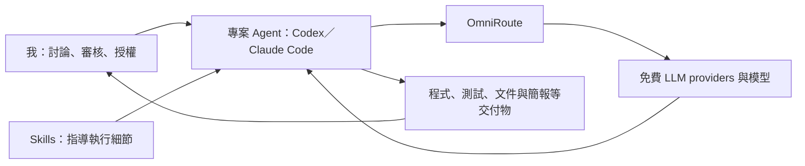
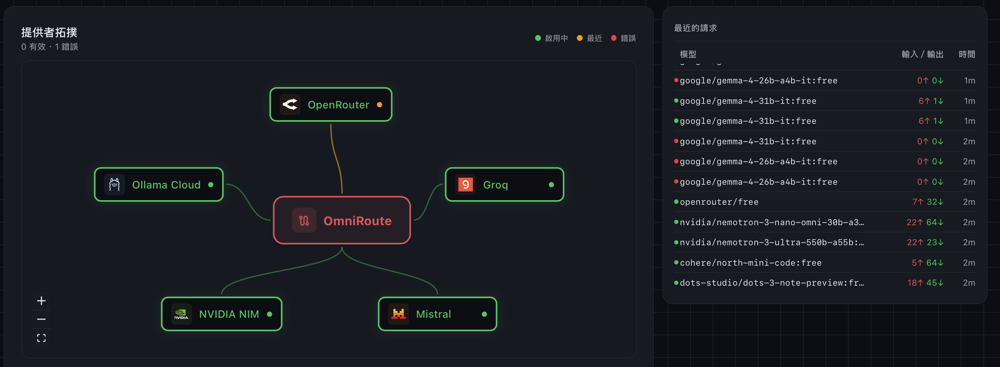
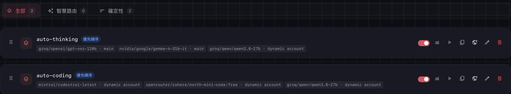
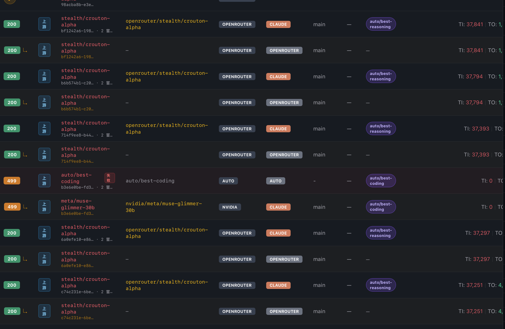
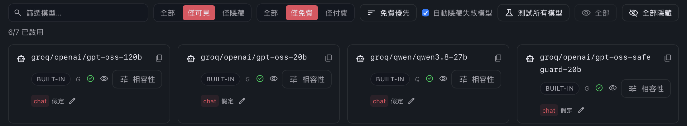
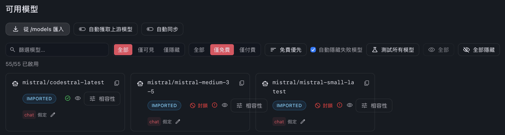
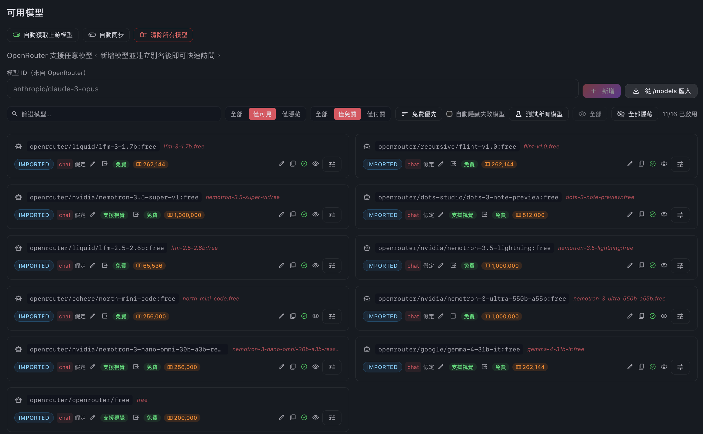
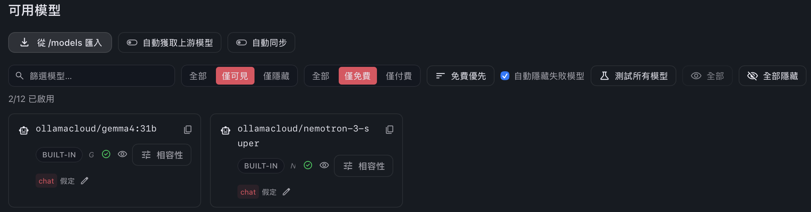
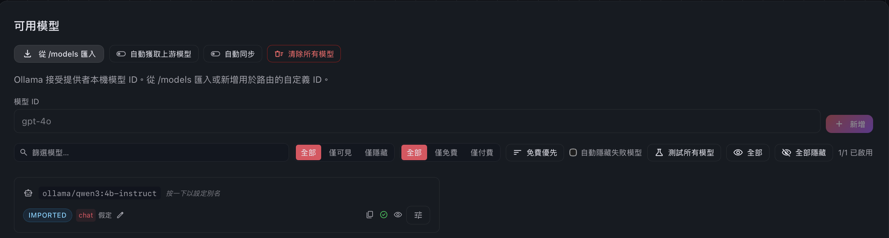
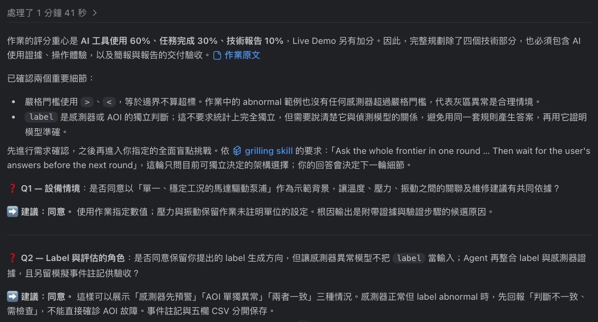

# AI 工具使用與 Agent 協作說明

本作業採用 **ALL FREE AI TOOLS 的 Agent 工作流程**：以 Codex／Claude Code 作為 Agent 執行介面，透過 OmniRoute 指定免費 LLM provider 與模型；系統運作時使用 Ollama＋Qwen3 地端推論。我負責計畫討論、執行結果審核與授權，Agent 依 skills 完成各階段細節。

以下依我確認的使用方式、實作紀錄與截圖整理。「免費」指本次採用的免費方案、模型或額度；可用範圍依供應商當時的規則與額度。

## 1. 人、Agent 與 skills 的分工

| 角色 | 責任 |
| --- | --- |
| **我／審核與授權者** | 提出目標與限制、討論計畫、審查程式與執行結果、核准後續階段及提交範圍 |
| **專案開發 Agent** | 閱讀需求與檔案、形成計畫、呼叫工具、修改程式、執行測試、除錯、美化、整理 PR，以及產製文件與簡報 |
| **Skills** | 指導需求確認、設計、程式簡化、審查與交付細節，讓 Agent 依明確方法執行 |
| **系統內的維修 Agent** | 根據本機證據提供維修解說，執行歷史查詢、交班摘要與工單修改預覽 |

專案 Agent 的執行範圍涵蓋程式與交付文件；書面報告及簡報也由 Agent 製作，再由我審核。正式 PDF 簡報與技術報告目前仍為後續交付，完成狀態見第 6 節。

## 2. ALL FREE AI TOOLS 的使用配置

| 階段 | 使用方式 | 產出／作用 |
| --- | --- | --- |
| 背景調查 | Gemini Deep Research 免費網頁版 | 產生工業預警與訊號意義的調查初稿，提供 Agent 作為規劃輸入；後續再核對原廠來源與實作範圍 |
| 專案執行 | Codex／Claude Code Agent＋OmniRoute＋免費上游模型 | 完成規劃、程式、驗證、設計、文件及 PR 等工作 |
| 工作方法 | 規劃、設計、審查與簡化程式等 skills | 約束 Agent 的執行方式，減少需求遺漏與重複修改 |
| 系統推論 | 本機 Ollama＋`qwen3:4b-instruct` | 維修情境解說與監測後三項問答 |

**本次未使用 Codex／Claude Code 會員方案提供的模型推論。** Coding agent 的操作與工具能力由客戶端提供，實際開發推論來源經 OmniRoute 指向我選用的免費 provider／模型；因此文件將 Agent 介面與上游模型分開列示。

開發階段的 OmniRoute 可使用免費雲端來源，包含 Ollama Cloud。系統執行則直接呼叫 `http://127.0.0.1:11434` 的本機 Qwen3，兩條資料路徑分開。模型與連線設定可見 [local_agent.py](../factory_agent/local_agent.py)。

一般使用者依 README 安裝 Python 即可啟動純終端模式；啟用系統內的維修 Agent 時，再準備本機 Ollama。

## 3. OmniRoute 的 provider、模型與使用證據

### 3.1 Provider 與代表配置

下表保留截圖中可辨識的 OmniRoute 模型 ID。模型清單與路由配置用於說明候選來源；實際請求另由紀錄佐證。

| Provider | 代表模型／入口 | 截圖依據 |
| --- | --- | --- |
| Groq | `groq/openai/gpt-oss-120b`、`groq/qwen/qwen3.8-27b` | [免費模型清單](screenshots/groq.png)、[路由組合](screenshots/first_combo.png) |
| NVIDIA NIM | `nvidia/google/gemma-4-31b-it` | [免費模型清單](screenshots/NVIDIA%20NIM.png)、[路由組合](screenshots/first_combo.png) |
| Mistral | `mistral/codestral-latest` | [免費模型清單](screenshots/Mistral.png)、[路由組合](screenshots/first_combo.png) |
| OpenRouter | `openrouter/cohere/north-mini-code:free`、`openrouter/openrouter/free` | [免費模型清單](screenshots/openrouter.png)、[路由組合](screenshots/first_combo.png) |
| Ollama Cloud | `ollamacloud/gemma4:31b`、`ollamacloud/nemotron-3-super` | [免費模型清單](screenshots/ollamacloud.png) |

`openrouter/openrouter/free` 為截圖中的免費路由入口。上方新增模型輸入欄中的範例文字不列入本表，模型 ID 以模型卡片、組合與請求紀錄為準。

Provider 配置與當時請求狀態；畫面也保留錯誤狀態，不作為所有來源都穩定可用的證明。

### 3.2 規劃與實作的路由組合

截圖將工作需求分為兩個組合，按畫面中的優先順序配置：

- **`auto-thinking`**：Groq `gpt-oss-120b` → NVIDIA NIM `gemma-4-31b-it` → Groq `qwen3.8-27b`。
- **`auto-coding`**：Mistral `codestral-latest` → OpenRouter `cohere/north-mini-code:free` → Groq `qwen3.8-27b`。

這些組合提供開發 Agent 的模型選擇；設備監測的門檻、模型分數與風險規則由專案程式處理。

### 3.3 實際請求紀錄

請求截圖可見 OpenRouter `stealth/crouton-alpha` 的 200 成功紀錄，也保留其他非 200 紀錄。組合名稱可能隨開發調整，因此以每筆請求的最終上游模型辨識實際來源。

此圖佐證路由與實際請求，不以畫面中的 token 數推估節省比例；客戶端／請求類型標記與最終上游模型分開閱讀。

<strong>查看各 provider 的免費模型清單與本機模型匯入畫面</strong>

**Groq**

**NVIDIA NIM**

**Mistral**

**OpenRouter**

**Ollama Cloud：開發階段的雲端來源**

**Ollama：本機 Qwen3 模型匯入紀錄**

此圖呈現本機模型匯入；系統程式的模型名稱為 `qwen3:4b-instruct`，直接連線本機 Ollama。

## 4. Skills 如何指導 Agent，控制溝通與 token 成本

| Skill／方法 | 執行細節 | 減少的重複工作 |
| --- | --- | --- |
| `grill-me`、`grilling` | 先釐清資料分布、label 角色、門檻邊界、驗收順序與設計盲點 | 需求未釐清就實作，導致後續反覆重寫 |
| `ponytail` | 優先最小完整變更，重用現有功能，控制依賴與程式複雜度 | 不必要的抽象、功能與重複實作 |
| `frontend-design`、`data-visualization`、`build-dashboard` | 指導配色、資訊層次、圖表、終端及結果頁呈現 | 缺乏設計準則造成的反覆試排與長篇口頭描述 |
| `code-review` | 從 Standards、Spec 兩路檢查標準、規格、效率與現實限制；先報告再按授權修改 | 無範圍的全案修改與未驗證的修補 |
| `pr` | 以變更摘要、前後證據及影響範圍整理提交 | 審閱者重新追溯對話與猜測變更目的 |

Skills 是 Agent 執行任務的方法指引，實際推論由上游 LLM 完成。使用目的為降低多餘 token 消耗與往返溝通；本次未量測節省的工時或 token 比例，以流程與交付物作為效率證據。

我討論與核定需求，Agent 依規劃 skills 問答並整理可執行規格。

## 5. 從討論到可驗證交付

協作流程為：**我討論計畫與授權 → Agent 依 skills 執行 → Agent 測試並交付 → 我審核結果 → 授權後續工作**。資料生成與純終端流程均先交付驗收，再進入後續階段。

| 具體案例 | 我的討論／審核 | Agent 執行與可驗證結果 |
| --- | --- | --- |
| 穩態與卡值 | 指出現代設備可能長時間維持相同量測 | 保留同值計數，取消僅靠重複值產生的告警；原始資料維持不變 |
| 模型改善 | 要求改善表現時保留有展示價值的提前預警 | 建立離線評估與回歸條件，保留第 301 筆模型警告、較第 310 筆嚴格超標提前 9 分鐘 |
| 問答可信度 | 核准 code review 中需要修正的範圍 | 固定查詢批次，由模型選擇事實、程式帶入關鍵內容，補上測試並整理 PR |

目前有 82 項回歸測試通過；模型、資料保護、備援與本機 Ollama 的實際工具流程另有驗證。測試用於檢查成果，不能換算成未量測的開發效率百分比。

完整階段核對及原始規劃對照見[專案計畫第 9、10 節](project%20plan.md#9-實作代辦清單)，修正與驗證可見 [PR #4](https://github.com/alanhsu0531/-Pegatron-Smart-Factory-Alert-Agent/pull/4)。

## 6. Agent 的文件與簡報交付範圍

| 交付項目 | 執行／審核分工 | 目前狀態 |
| --- | --- | --- |
| 程式、資料、測試與終端展示 | Agent 執行，我分階段審核與授權 | 已實作與驗證 |
| README、計畫與 AI 工具使用說明 | Agent 撰寫與排版，我審核 | 已整理，持續依審核調整 |
| PDF 簡報 | 後續由 Agent 依簡報相關 skills 整理內容、圖表與版面，我審核 | 待製作 |
| 2–3 頁技術報告 PDF | 後續由 Agent 依文件／PDF 相關 skills 撰寫、排版與檢查，我審核 | 待製作 |

正式交付會延續相同的 Agent 執行、skills 指導及我審核授權流程；尚未製作的簡報與報告不列為已完成成果。
