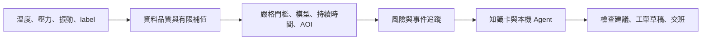

# 工業設備異常預警 AI Agent：背景調查與設計依據

本調查用於選擇訊號、預警方式與維修建議，**研究方向不等於已實作功能**。本專案採單一馬達驅動泵浦情境；未指定設備型號、轉速、負載、製程週期及感測器規格，以下提供檢查方向，不構成故障確診。

## 一、工業監測系統關注什麼

設備監測的目的，是把量測轉成「哪裡需要注意、先檢查什麼、如何留下維修紀錄」。Siemens Senseye 的資料整合文件將狀態指標與工況資訊共同用於觀察設備劣化；Sulzer 的現場檢查則同時核對運轉條件、振動、溫度、洩漏與異音。[Senseye Machine Data](https://developer.siemens.com/senseye/machine/index.html)、[Sulzer Inspection and analysis](https://www.sulzer.com/en/shared/services/inspection-and-analysis)。

依這些資料整理的工程設計方向如下；這是本專案的設計歸納，並非宣稱每個商用系統都包含所有功能。

| 方向 | 要解決的問題 | 本專案的取捨 |
| --- | --- | --- |
| 資料擷取與品質 | 缺值、錯誤碼、量測來源不可信 | CSV 逐筆重播；品質分級與最多兩分鐘前值暫補 |
| 工況與多變量基準 | 單欄未超標，但共同變化已異常 | 單工況 Isolation Forest，加灰區聯合規則 |
| 告警分級與抑制 | 一次尖峰與持續惡化需要不同處理 | 門檻、連續條件、事件合併與恢復觀察 |
| 根因提示與處置 | 異常訊號不直接等於零件故障 | 固定檢查知識卡，加本機模型情境解說 |
| 維修紀錄 | 告警解除後仍需交接與追蹤 | 本機工單草稿、批次歷史與修訂版本 |
| 更大範圍的預測維護 | 多工況、RUL、模型更新與企業整合 | 本次未實作，避免擴張作業範圍 |

## 二、三個感測器各自能說明什麼

### 2.1 振動：機械狀態的變化線索

振動可用於觀察馬達、軸承、聯軸器等旋轉部件的狀態；不尋常的振動可能與磨耗、不對心、不平衡或鬆動有關。感測器安裝與量測頻率也會影響讀值。[NI What is Vibration Monitoring?](https://www.ni.com/en/solutions/condition-monitoring/what-is-vibration-monitoring.html)、[NI Measuring Vibration with Accelerometers](https://www.ni.com/en/shop/data-acquisition/sensor-fundamentals/measuring-vibration-with-accelerometers.html)。

本專案每分鐘僅有一個振動數值，且未指定是加速度、速度、位移、RMS 或其他指標。因此只能提示量值與趨勢變化，不能作 FFT、特徵頻率判讀或軸承故障分類。振動以恆正 Gamma 分布模擬，並非原始振動波形。

### 2.2 溫度：熱狀態與負載的交叉證據

泵浦及旋轉機械檢查會觀察軸承、冷卻等位置的溫度，也需對照工況與其他量測。溫升可作為檢查負載、冷卻與潤滑狀態的方向，不能單憑高溫確認磨損或過載。[Sulzer Inspection and analysis](https://www.sulzer.com/en/shared/services/inspection-and-analysis)。

本專案以常態基線、兩分鐘潛在狀態延遲及漸升事件呈現熱反應。這是模擬設定，不代表所有設備都固定落後兩分鐘，也不能保證溫度總比振動晚出現異常。

### 2.3 壓力：流體系統與操作條件的線索

泵浦診斷需對照流量、揚程、轉速、閥件及系統條件，而非只看單一壓力。壓力與振動一起偏離時，可優先核對現場儀表，再檢查供壓、管路流通、進氣及機械狀態；候選方向不等於確診。[Sulzer Inspection and analysis](https://www.sulzer.com/en/shared/services/inspection-and-analysis)、[Vertical Pump Troubleshooting Guide](https://www.sulzer.com/en/-/media/files/products/pumps/vertical-pumps/brochures/vertical_pump_troubleshooting_guide_en_e00669.pdf)。

本專案未指定壓力單位、量測位置或泵浦曲線，因此沿用作業數值門檻，不推算流量、效率或氣蝕機率。

### 2.4 為什麼不能只看連續相同值

穩定工況及有限回報精度可能讓數值連續相同；本專案振動只保留兩位小數，更容易出現重複值。若缺少採集心跳、序號、感測器內部時間或與負載變動的對照，無法確認資料是否卡住。

因此目前只記錄連續同值筆數，不發卡值告警。原始固定值事件仍保留，以呈現這項可觀測性的限制；缺值與 999 則另外列為明確的資料品質問題。

## 三、AOI label 與模型的關係

視覺檢測通常用於物件、產品缺陷及組裝驗證；產品 NG 不應直接當成設備故障。這項區分可由 Cognex 的缺陷檢測與組裝驗證用途看出；是否與設備故障相連，仍需現場驗證。[Cognex In-Sight 3800](https://docs.cognex.com/isvs_2520/web/EN/is3800-manual/Content/Topics/getting-started/about-device.htm)。

依作業欄位，本專案將 `label` 視為模擬的外部設備狀態回報：

- **訓練與校準：** Isolation Forest 只使用溫度、壓力與振動，不使用 label，也不依它挑選訓練樣本。
- **即時判定：** abnormal label 形成關注；連續三筆形成警告，與感測器及模型交叉確認。
- **離線評估：** 分開比較模型與設備事件窗口、模型與 label，不把兩種答案混成同一個指標。

label 在量化後的設備量測上依機率生成，再注入通訊錯誤與缺值。因此它與量測有條件關聯；少量正常量測仍可能標 abnormal，用來呈現外部判斷不一致，不能據此認定 AOI 硬體確實故障。

## 四、採用的預警與 Agent 流程

這是依本作業資料量與操作門檻做的工程取捨：規則保留明確物理邊界，Isolation Forest 補足多變量偏離提醒，連續條件降低短暫波動的影響，事件追蹤避免重複開單。模型原理參考 [scikit-learn 1.6 IsolationForest](https://scikit-learn.org/1.6/modules/generated/sklearn.ensemble.IsolationForest.html)。

本機語言模型負責解說與工具選擇，風險、工單狀態及是否儲存仍由程式與使用者控制。歷史查詢與交班以已保存事實組成回答；目前無設備手冊檢索、RAG、RUL 預測、動態基準、多工況分類、即時 PLC 連線或外部 CMMS 串接。

實作細節與操作方式見 [README](../README.md)，分布參數、原始規劃及階段驗收見[專案計畫](project%20plan.md)。

## 五、來源使用範圍

以上連結為可追溯的原廠或套件文件，於 2026-11-07 核對。來源支撐工業訊號、現場檢查與工具原理；**作業門檻、分布參數、相關矩陣、熱延遲及驗收數字來自本專案設定與測試**，不是來源宣告的通用工業標準。
